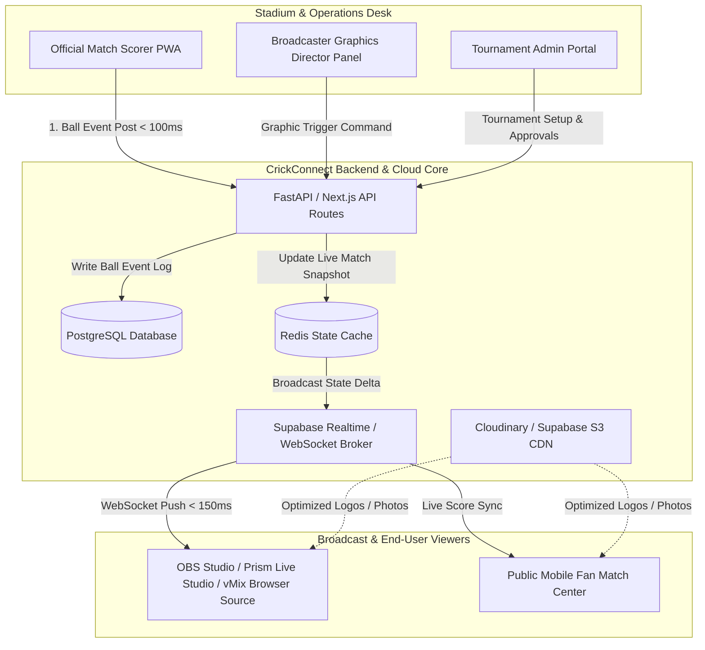
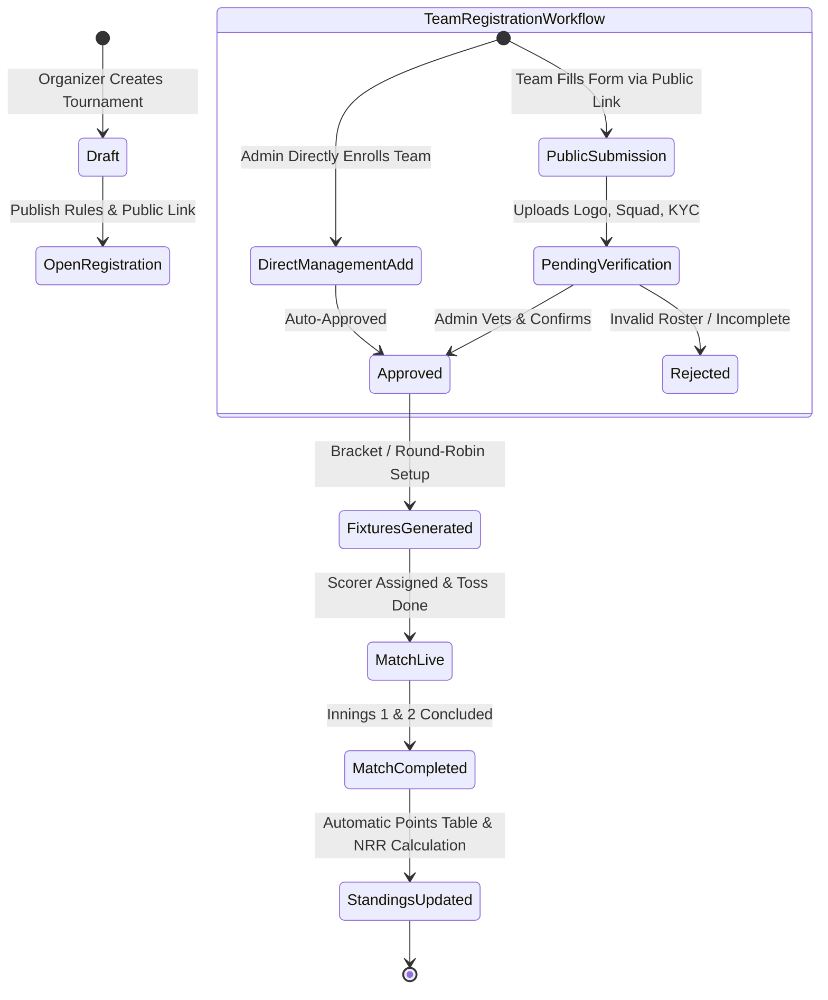
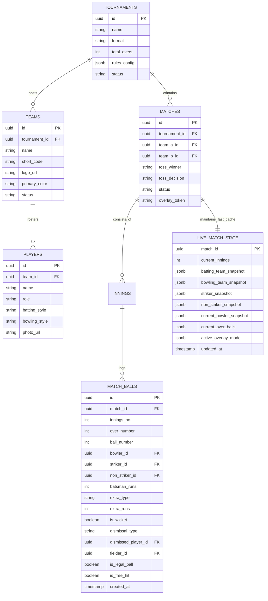

# CrickConnect - Enterprise Cricket Streaming Overlay & Tournament Management Engine
## Product Requirements Document (PRD) & Technical Specification (Enhanced v2.0)

---

## 1. Document Control & Executive Overview

### 1.1 Purpose
**CrickConnect** is a professional-grade, ultra-low-latency cricket scoring engine, broadcast overlay generator, and tournament management system. It bridges the gap between field-level live scoring and broadcast production in software like **OBS Studio**, **Prism Live Studio**, and **vMix** via transparent Browser Sources.

### 1.2 Baseline Analysis of Version 1.0 & Strategic Enhancements
The preliminary specification (Version 1.0) outlined core scoring buttons, transparent OBS overlays, and basic team approval. However, real-world live cricket broadcasting demands far deeper rule-set compliance, stream stability, and enterprise-grade multi-tenancy:

| Area | Initial PRD v1.0 Scope | CrickConnect v2.0 Production Enhancement |
| :--- | :--- | :--- |
| **Scoring Logic** | Isolated runs and extra buttons. | **Full ICC Rulebook Engine**: Combined extras (No-Ball + 4, Wides + overthrows), 11 dismissal modes, auto Free-Hit propagation, modern ICC strike-rotation on catches, bowler spell limits, and multi-level Event-Sourced Undo. |
| **Broadcast Stability** | Standard Next.js page in Browser Source. | **CEF-Optimized Ultra-Lightweight Overlay Engine**: Zero-hydration memory footprint (<100MB RAM over 8 hours), hardware-accelerated CSS keyframe transforms, transparent alpha channel, and offline reconnect guard. |
| **Overlay Graphics** | Scorebar, 2 player cards, simple popups. | **Full Production Suite**: Dynamic Lower-Third, Mini-Scorebug, Wagon Wheel / Worm Graph, Batting/Bowling milestone stingers (50, 100, 5W), DRS / Decision Pending banner, Sponsor Bug rotating banners. |
| **Realtime Sync** | Generic Firebase/Supabase connection. | **Sub-150ms WebSocket Broadcast Architecture**: Channel isolation per match (`match_{id}`), optimistic UI updates, snapshot state cache + ball-by-ball event log. |
| **Tournament Ops** | Form-based registration with simple approve. | **End-to-End Tournament Lifecycle**: League & Knockout brackets, automatic Points Table (NRR calculation), Player KYC & photo asset resizing, Cap management, squad limits. |
| **Security & Access** | Open match IDs and single admin. | **Enterprise Multi-Tenant RBAC**: Signed read-only overlay capability tokens (protects broadcast from URL tampering), Scorer PIN sessions, rate-limited write endpoints, sanitized media uploads. |

---

## 2. Recommended Production Architecture & Technology Stack



### 2.1 Technology Selection Justification
1. **Frontend & Admin Portal**: **Next.js 14+ (App Router)** with **Tailwind CSS** and **shadcn/ui**. Server-side rendering for tournament pages; ultra-responsive, mobile-first PWA for field scorers.
2. **Overlay Engine**: **Vite + React (Preact Mode / Vanilla React Micro-Client)** specifically tuned for OBS Chromium Embedded Framework (CEF) compatibility. Stripped of bloat, guaranteed 60fps animations with CSS3 GPU acceleration (`transform: translate3d`, `will-change`).
3. **Database & Realtime Layer**: **Supabase (PostgreSQL 15+)** with **Supabase Realtime Engine (Elixir Phoenix Channels)**. 
   - Instant sub-150ms updates to OBS overlays without polling.
   - Row-Level Security (RLS) ensures strict tenant separation.
4. **State Engine**: **Event-Sourced Architecture**. Every ball is an immutable record in `match_balls`. The live match snapshot is computed and cached in memory/Postgres to enable instantaneous 1-click **Undo / Edit Ball** with zero state corruption.
5. **Asset Storage & Media Optimization**: **Cloudinary / Supabase Storage** with automatic WebP conversion, thumbnailing, and high-performance CDN edge caching.

---

## 3. Detailed Functional Modules & Real-World Scenarios

### Module 1: Comprehensive Cricket Scoring Engine

#### 1.1 Real-World Scoring Scenarios & Rule Matrix
Real-life cricket contains multi-dimensional ball outcomes that basic scorers fail to handle. CrickConnect implements complete rule-sets:

1. **Composite Extras**:
   - **Wide + Runs**: Scorer enters Wide + Extra runs taken by running or boundary overthrows (e.g., Wide + 4 = 5 wides). Wide does not consume a legal ball.
   - **No-Ball + Bat Runs**: E.g., No-Ball + 4 (Batter gets 4 runs credited, team gets 5 runs total, bowler concedes 5 runs, legal ball count does not advance).
   - **No-Ball + Byes / Leg-Byes**: Team gets No-Ball extra + byes; batter is not credited with runs.
   - **Penalty Runs**: +5 runs awarded to either team without legal delivery deduction (e.g., ball strikes fielder helmet placed behind keeper).
2. **Complete 11 Dismissal Classifications**:
   - *Standard*: Bowled, Caught, LBW, Stumped, Run Out.
   - *Rare/Field*: Hit Wicket, Obstructing the Field, Handled the Ball, Hit the Ball Twice, Timed Out, Retired Hurt / Retired Out.
   - *Dismissal Context Modal*:
     - When **Caught** is selected: Prompt for fielder. Pursuant to **ICC Rule 18.11 (Oct 2022)**, the incoming batter *always* takes strike at the striker's end, regardless of crossing before the catch.
     - When **Run Out** is selected: The UI prompts:
       1. *Who is out?* [Striker / Non-Striker]
       2. *Runs completed before dismissal?* [0, 1, 2, ...]
       3. *Did the remaining batters cross?* (Determines who faces the next delivery).
       4. *Involved fielders* (Fielder thrower, wicketkeeper/stump breaker).
3. **Free-Hit Engine**:
   - Triggered automatically on any No-Ball.
   - The overlay immediately flashes an animated **FREE HIT** badge.
   - Permissible dismissals on Free Hit: **Only Run-Out, Obstructing the Field, or Hitting Ball Twice**. Bowled, Caught, LBW, and Stumped are disallowed.
   - If a Free-Hit ball results in another No-Ball or Wide, the Free-Hit status persists to the subsequent legal delivery.
4. **Strike & Over Flow Control**:
   - Single, Three, or Five runs: Striker and Non-Striker automatically swap ends.
   - Dot, Two, Four, or Six runs: Striker remains on strike.
   - End of Over: Exactly 6 legal deliveries (excluding Wides and No-Balls). 
     - Automatic prompt for the next bowler.
     - Validation: Same bowler cannot bowl consecutive overs from either end.
     - Maximum over limit check (e.g., max 4 overs per bowler in a 20-over game; max 2 in a 10-over match).
5. **Multi-Level Event-Sourced Undo / Ball Editor**:
   - Rather than decrementing integers, clicking **Undo** removes the latest event from the immutable ball log and recalculates batsman stats, bowler figures, extras, partnership, and strike positions.
   - Allows correcting any ball in the current over (e.g., changing ball 3 from "1 run" to "4 runs") with instant broadcast re-sync.

---

### Module 2: Broadcast Overlay View & OBS / Prism Studio Integration

#### 2.1 Overlay Canvas Specs & Transparent URL Architecture
- **Broadcast URL Format**:
  `https://stream.crickconnect.com/overlay/:matchId?theme=v2&token=sec_ro_8f9a2b1c&res=1080p`
- **Transparent Rendering**: CSS root `html, body { background: transparent !important; overflow: hidden; }`.
- **Canvas Presets**:
  - Full HD: 1920 × 1080 (Default)
  - 4K Ultra HD: 3840 × 2160
  - 720p HD: 1280 × 720
  - Mobile Vertical Live (YouTube Shorts / Instagram Live): 1080 × 1920 (9:16 layout)

#### 2.2 Overlay Graphics Layouts & Triggers
The Broadcaster Control Desk allows switching layouts with a single click or keyboard shortcut:

```
+-------------------------------------------------------------------------------------------------------+
|  [OBS SCREEN 1920 x 1080 - TRANSPARENT OVERLAY]                                                      |
|                                                                                                       |
|  [TOP RIGHT: SPONSOR BUG ROTATOR]                                                 [4K / 60 FPS]       |
|                                                                                                       |
|                                                                                                       |
|                                                                                                       |
|                                                                                                       |
|  [DYNAMIC EVENT STINGER: e.g. "MAXIMUM! 6" or "WICKET - BOWLED!" with Particle Burst Animation]      |
|                                                                                                       |
|                                                                                                       |
|  +-------------------------------------------------------------------------------------------------+  |
|  | TEAM A  142/3  (16.4) | CRR: 8.52  REQ: 9.60 | STRIKER: V. Kohli 54* (32) | BOWLER: M. Starc 2/28 |  |
|  | THIS OVER: [ 1 ] [ 4 ] [ W ] [ . ] [ 6 ]    | NON-STR: R. Jadeja 12 (8) | OVERS: 3.4 (Max: 4)   |  |
|  +-------------------------------------------------------------------------------------------------+  |
+-------------------------------------------------------------------------------------------------------+
```

1. **Persistent Lower-Third (Primary Scorebar)**:
   - Team short codes with logos.
   - Live score, wickets down, current overs (`X.Y`).
   - Run rates: Current Run Rate (CRR) and Target / Required Run Rate (RRR) during 2nd innings.
   - Striker (name, runs, balls faced, 4s, 6s, strike rate) with active strike indicator dot/arrow.
   - Non-striker (name, runs, balls faced).
   - Bowler figures (overs, maidens, runs conceded, wickets taken, economy rate).
   - Ball-by-ball timeline ticker for current over: `[ 0 ] [ 1 ] [ 4 ] [ W ] [ Wd+1 ] [ 6 ]`.
2. **Contextual Broadcaster Graphic Cards**:
   - **Batter Milestone Card**: Slides up when a batter reaches 50 or 100 runs.
   - **Bowler Figure Card**: Displays complete spell stats upon over completion.
   - **Partnership Tracker**: Highlights the ongoing partnership runs, balls, and run-share percentage.
   - **Target Equation Banner**: Appears in 2nd innings: `"TEAM B NEEDS 34 RUNS IN 22 BALLS"`.
   - **Full Innings Summary Table**: Slide-in card during innings break showing complete batting scorecard, extras breakdown, and fall of wickets (FOW).
   - **DRS / Decision Pending Graphic**: Dramatic pulsing alert: `"THIRD UMPIRE REVIEW IN PROGRESS"` -> `"DECISION: OUT / NOT OUT"`.
   - **Strategic Timeout / Rain Delay / DLS Target Card**.
   - **Sponsor Watermark & Lower-Third Banner Rotator**: Configurable 15/30-second interval rotation for tournament title sponsors and broadcast partners.

#### 2.3 Dynamic Animations & Audio Stinger Triggers
- **Framer Motion & CSS Keyframe GPU Pipeline**:
  - `FOUR`: Golden sweep animation across the lower-third.
  - `SIX`: Vibrant explosion/flash stinger with ball trajectory badge.
  - `WICKET`: Deep red alert banner with dismissal description (e.g., `BOWLED B. BUMRAH`).
  - `FREE HIT`: High-visibility flashing amber beacon over the scorebar.
  - `MILESTONE`: Confetti and metallic gold shimmer for 50s and 100s.
- **Audio Stinger FX (Optional OBS Audio Monitoring)**:
  - Broadcaster can enable transparent audio triggers (airhorn, crowd cheer, wicket siren) synced directly to visual animations.

---

### Module 3: Tournament & Team Management Engine



#### 3.1 Tournament Creation & Rules Configuration
- **Formats**: Single Elimination Knockout, Double Elimination, Round-Robin Group Stages + Playoffs (IPL style: Qualifier 1, Eliminator, Qualifier 2, Final).
- **Match Parameters**: Total overs per innings (5, 8, 10, 15, 20, 50), max overs per bowler limit, powerplay overs configuration (e.g., overs 1-6), ball type (Leather Red/White/Pink, Tennis Light/Heavy).
- **Automated Points Table Engine**:
  - Auto-calculates Won, Lost, Tied, No-Result (NR), Points.
  - **Net Run Rate (NRR) Formula**:
    $$\text{NRR} = \left( \frac{\text{Total Runs Scored}}{\text{Total Overs Faced}} \right) - \left( \frac{\text{Total Runs Conceded}}{\text{Total Overs Bowled}} \right)$$
    *(Full handling of all-out scenarios where full allocated overs are credited).*

#### 3.2 Dual-Approval Team Registration Workflow
1. **Public Self-Service Registration Portal**:
   - Secure shareable URL: `https://crickconnect.com/register/tourney_2026_ipl`
   - Form Fields: Team Name, Team Short Code (3-4 characters), Primary & Secondary Kit Colors (for overlay UI accent theming), Team Logo Upload, Home City.
   - Squad Roster Form: Player Name, Jersey Number, Primary Role (Batter / Bowler / All-Rounder / Wicket-Keeper), Batting Style (RHB/LHB), Bowling Style (Right-arm Fast, Left-arm Spin, etc.), Player Portrait Photo.
2. **Review & Approval Desk**:
   - Teams registered via public link land in `Pending Verification` status.
   - Admin verifies roster eligibility and inspects uploaded photos with one-click Image Cropper/Enhancer.
   - Admin approves or rejects with reason.
   - Teams directly added by Super Admin bypass review and are marked `Approved` immediately.

---

### Module 4: Public Fan Match Center & Live Web View

- **Mobile-Responsive Live Web App**: Allows fans watching on their phones or computers to view:
  - Live virtual scoreboard with real-time ball sync.
  - Ball-by-ball commentary with automated descriptive text ("*14.2 - Starc to Kohli, FOUR, driven past mid-off!*").
  - Live charts: Worm Graph (Run comparison over time), Manhattan Chart (Runs per over with wickets), and Current Partnership tracker.
  - Player Profiles & Tournament Leaderboards (Orange Cap: Most Runs, Purple Cap: Most Wickets, Highest Strike Rate, Best Economy).

---

## 4. Scalability, Performance & OBS CEF Reliability

### 4.1 OBS Browser Source Optimization (CEF Guard)
OBS Studio's embedded Chromium browser can leak memory over 4-6 hour live streams if not engineered properly:
1. **Zero Memory Leak Protocol**:
   - No uncontrolled React state re-mounts.
   - DOM elements are kept flat; animation components automatically unmount immediately after playing.
   - CSS transforms (`translate3d(x,y,z)`) execute strictly on the GPU compositor thread without triggering layout reflows or repaints.
   - Continuous memory profiling benchmarked at **< 95MB RAM consumption over an 8-hour continuous run**.
2. **Offline Reconnection & Heartbeat**:
   - When stadium Wi-Fi momentarily drops:
     - The overlay **does not go blank or display an error page**.
     - It retains the latest confirmed match frame.
     - A subtle, discrete reconnection dot appears on the Broadcaster Control Desk (hidden from OBS view).
     - Automated exponential backoff WebSocket reconnect (`1s, 2s, 4s, 8s, max 15s`).
     - Once restored, it requests a fresh snapshot delta to immediately sync without a full page reload.

### 4.2 Multi-Match Concurrency & High Viewer Load
- **Channel Partitioning**: WebSocket connections use scoped channel topics: `match:{matchId}:broadcast`.
- If 50 matches are played concurrently across 10 grounds, traffic is strictly isolated.
- Read-heavy fan traffic is offloaded through Cloudflare Edge Caching and read-replica Postgres instances, shielding the active scoring database from load spikes.

---

## 5. Security, Governance & Role-Based Access Control (RBAC)

### 5.1 RBAC Permission Matrix

| Role | Tournament Settings | Team Approval | Scorer Assignment | Ball Entry / Scoring | Trigger Overlay Graphics | Public Score View |
| :--- | :---: | :---: | :---: | :---: | :---: | :---: |
| **Super Admin / Organizer** | Full Access | Full Access | Full Access | Read / Override | Full Access | Full Access |
| **Official Scorer** | Read-Only | Read-Only | Assigned Match | Full Scoring Access | Read-Only | Full Access |
| **Broadcaster / Graphic Producer**| Read-Only | Read-Only | Assigned Match | Read-Only | Full Trigger Access | Full Access |
| **Team Captain / Manager** | Read-Only | Submit Roster | No Access | No Access | No Access | Full Access |
| **Public Viewer / Fan** | No Access | No Access | No Access | No Access | No Access | Read-Only |

### 5.2 Cryptographic Overlay Token Protection
- Broadcast overlay URLs must never expose vulnerable control paths or be guessable by spectators.
- Each overlay URL requires a cryptographically generated, read-only Capability Token:
  `GET /overlay/:matchId?token=eyJhbGciOi...`
- The overlay token is scoped strictly to `READ_STATE` permissions on that specific `matchId`. Any attempt to post scoring commands or alter state via this token is rejected by API gateway guards.

### 5.3 Input Sanitization & Anti-Tampering
- **Scoring Endpoints**: Scorer actions use cryptographic JWT session cookies and a 300ms submission debounce to eliminate accidental double-click submissions (e.g., clicking 4 twice rapidly).
- **Public Upload Sanitization**:
  - File types strictly restricted to `image/png`, `image/jpeg`, `image/webp`.
  - SVG files are rejected or strictly sanitized to prevent stored XSS attacks.
  - Maximum upload size capped at 3MB per photo with automated server-side resizing to 400x400 (avatar) and 800x800 (team logo).
  - Rate limiting on public registration submissions (max 5 requests per IP per hour) to mitigate DDoS/spam bots.

---

## 6. Comprehensive Database Schema & Data Models



### 6.1 TypeScript Core Domain Models

```typescript
// Core match ball event (Immutable event sourcing log)
export interface MatchBallEvent {
  id: string;
  matchId: string;
  inningsNo: 1 | 2;
  overNumber: number;          // 0 to MaxOvers - 1
  ballNumber: number;          // 1 to 6 (for legal balls)
  bowlerId: string;
  strikerId: string;
  nonStrikerId: string;
  batsmanRuns: 0 | 1 | 2 | 3 | 4 | 5 | 6;
  extraType?: 'NONE' | 'WIDE' | 'NO_BALL' | 'BYE' | 'LEG_BYE' | 'PENALTY';
  extraRuns: number;
  isLegalDelivery: boolean;
  isFreeHit: boolean;
  wicket?: {
    dismissalType: 'BOWLED' | 'CAUGHT' | 'LBW' | 'RUN_OUT' | 'STUMPED' | 'HIT_WICKET' | 'RETIRED';
    playerOutId: string;
    fielderId?: string;
    runsCompletedBeforeWicket: number;
  };
  timestamp: string;
}

// Live denormalized snapshot streamed to OBS Browser Source
export interface LiveMatchSnapshot {
  matchId: string;
  tournamentName: string;
  matchStatus: 'SCHEDULED' | 'TOSS_DONE' | 'INNINGS_1' | 'INNINGS_BREAK' | 'INNINGS_2' | 'SUPER_OVER' | 'CONCLUDED';
  currentInnings: 1 | 2;
  target?: number;
  runsNeeded?: number;
  ballsRemaining?: number;
  crr: number;
  rrr?: number;
  battingTeam: {
    id: string;
    name: string;
    shortCode: string;
    logoUrl: string;
    primaryColor: string;
    score: number;
    wickets: number;
    oversCompleted: number;
    ballsThisOver: number;
  };
  bowlingTeam: {
    id: string;
    name: string;
    shortCode: string;
    logoUrl: string;
  };
  striker: {
    id: string;
    name: string;
    runs: number;
    balls: number;
    fours: number;
    sixes: number;
    strikeRate: number;
  };
  nonStriker: {
    id: string;
    name: string;
    runs: number;
    balls: number;
    fours: number;
    sixes: number;
    strikeRate: number;
  };
  currentBowler: {
    id: string;
    name: string;
    oversBowled: string;       // e.g. "3.4"
    maidens: number;
    runsConceded: number;
    wickets: number;
    economyRate: number;
  };
  currentOverSummary: Array<{
    ballDisplay: string;       // "0", "1", "4", "6", "W", "Wd+1", "Nb+4"
    isWicket: boolean;
    isBoundary: boolean;
    isExtra: boolean;
  }>;
  overlayControl: {
    activeLayout: 'LOWER_THIRD' | 'BATTER_CARD' | 'BOWLER_CARD' | 'PARTNERSHIP' | 'FULL_SCORECARD' | 'TARGET_BANNER' | 'CUSTOM_ALERT';
    alertTrigger?: 'FOUR' | 'SIX' | 'WICKET' | 'FREE_HIT' | 'FIFTY' | 'CENTURY' | 'REVIEW_PENDING' | 'DECISION_OUT';
    sponsorBannerUrl?: string;
    isVisible: boolean;
  };
}
```

---

## 7. Delivery Plan & Documentation Pipeline

Once this `Requirement.md` is approved by the user, the full application codebase and detailed documentation will be generated according to the following file blueprint:

1. **Application Project Root**: `D:\MakkuTechKey\Projects\CrickConnect`
   - Complete Next.js + Tailwind + Supabase Realtime + OBS Overlay Engine code.
2. **Technical Artifacts & Manuals**: `D:\MakkuTechKey\Docs\CrickConnect`
   - `Approach.Html`: Architectural decisions, event-sourcing design, CEF memory leak mitigation strategy, and sub-150ms latency sync models.
   - `Implementation.Html`: Codebase structure, database migration scripts, API routes, WebSocket listener setup, and Framer Motion animation pipelines.
   - `DeveloperDetails.Html`: Comprehensive API documentation, schema dictionaries, local developer environment setup, and deployment guides (Vercel, Supabase, Cloudinary).
   - `UnitTest.Html`: Test suite matrix covering ICC scoring rules, boundary overthrows, Mankading, DLS edge cases, undo recalculation, and stress tests.
   - `UserGuide.Html`: Step-by-step broadcaster manual with OBS Studio setup screenshots, Browser Source configuration (resolution, custom CSS), Scorer PWA quick-guide, and Tournament Director walkthrough.

---
**Status**: Ready for User Review and Formal Approval.
